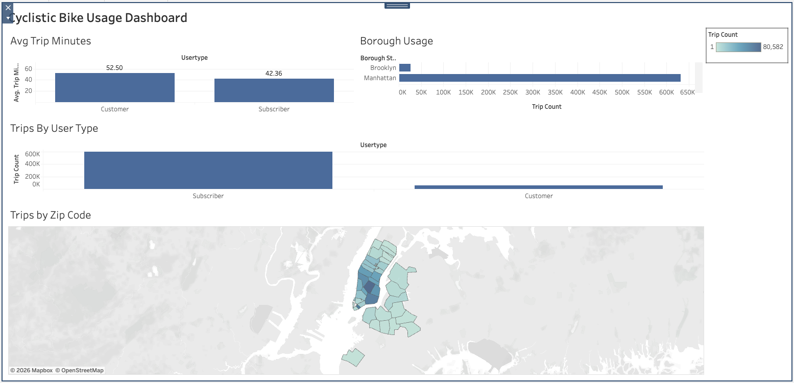

# Cyclistic Bike-Sharing Analytics Dashboard

## Project Overview

This project analyzes bike-sharing trip data from New York City to explore rider behavior, trip duration, geographic usage patterns, and differences between customer segments.

Using **SQL, Google BigQuery, and Tableau**, I combined trip, weather, and geographic data to develop an interactive Business Intelligence dashboard.

The goal was to transform raw data into meaningful insights that could support operational planning, customer analysis, and data-driven decision-making.

## Interactive Dashboard

**[View the Live Tableau Dashboard](https://public.tableau.com/app/profile/farnaz.sasanian/viz/CyclistBikeUsageDashboard/Dashboard1)**

### Dashboard Preview

## Project Objectives

- Analyze bike-sharing usage patterns across New York City.
- Compare trip behavior between subscribers and customers.
- Identify high-demand boroughs and zip codes.
- Explore differences in average trip duration.
- Create an interactive dashboard to communicate business insights.

## Tools & Technologies

| Tool | Purpose |
|---|---|
| SQL | Data querying, joining, and aggregation |
| Google BigQuery | Data preparation and analysis |
| Tableau Public | Interactive visualization and dashboard development |
| CSV | Data storage and analysis |

## Project Workflow

### 1. Data Preparation

- Worked with bike-sharing trip data.
- Combined trip, weather, and geographic information using SQL and BigQuery.
- Prepared the resulting dataset for visualization in Tableau.

### 2. Data Analysis

Analyzed several key performance indicators:

- **Trip Count:** Total number of bike trips.
- **Average Trip Duration:** Average trip length in minutes.
- **Borough Usage:** Distribution of trips across NYC boroughs.
- **Zip Code Activity:** Geographic patterns in bike usage.
- **User Type:** Differences between subscribers and customers.

### 3. Data Visualization

Developed an interactive Tableau dashboard to communicate the analysis results.

The dashboard includes geographic visualizations, usage metrics, and interactive filtering to help users explore travel patterns and customer segments.

## Key Findings

Based on the dashboard analysis:

- **Customer Behavior:** Subscribers accounted for more bike trips than customers.
- **Geographic Demand:** Manhattan showed the highest bike usage among the boroughs analyzed.
- **Trip Duration:** Average trip duration differed between subscribers and customers.
- **Geographic Patterns:** Certain zip codes showed higher bike activity, indicating concentrated areas of demand.

These findings demonstrate how business intelligence tools can help identify usage trends and support operational decisions.

## Repository Files

| File | Description |
|---|---|
| [cyclistic_query.sql](cyclistic_query.sql) | SQL queries used for data preparation and analysis |
| [Cyclistic NYC.csv](Cyclistic%20NYC.csv) | CSV dataset included in the repository |
| [dashboard.png](dashboard.png) | Dashboard screenshot |
| README.md | Project overview, methodology, and findings |

## Potential Business Applications

The dashboard can support exploration of:

- Customer usage behavior and segmentation.
- Geographic demand for bike-sharing services.
- Differences in travel patterns and trip duration.
- Opportunities for more targeted operational planning.

## Future Improvements

- Explore seasonal and hourly usage patterns.
- Investigate relationships between weather conditions and trip activity.
- Develop additional customer segmentation metrics.
- Expand the dashboard with new performance indicators.

##👩‍💻 Author

**Farnaz Sasanian**

M.S. in Data Science — Illinois Institute of Technology

[GitHub](https://github.com/fsasanian) | [LinkedIn](https://www.linkedin.com/in/fsasanian/) | [Tableau Portfolio](https://public.tableau.com/app/profile/farnaz.sasanian/vizzes)
